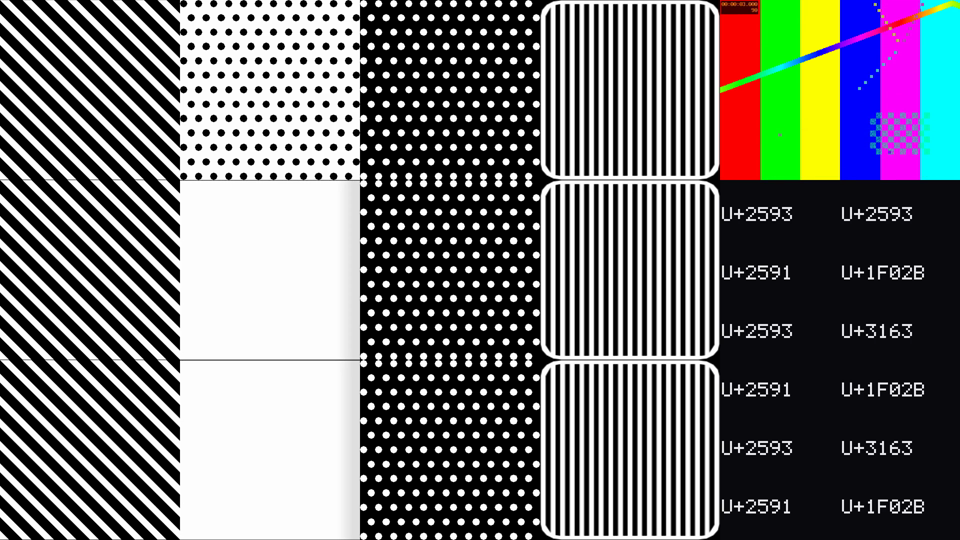

# glyphmosaic

Turn any video into a mosaic of **real Unicode font glyphs** — one glyph per
grid cell, chosen by coarse-to-fine mean-squared-error search against a
rendered font dictionary, with an optional exhaustive `--exact` mode.

This is a from-scratch, open-source implementation of the technique behind
"Bad Apple!! but it's 12 Unicode characters per frame (4×3)": every frame is
split into a `cols × rows` grid, each cell is matched to a single visible
Unicode character, and the chosen glyph is stretched to fill the cell.

No AI image generation. Every pick is a real font glyph.



*Synthetic test clip rendered at 4×3 with the side panel (1920×1080).*

## Quick start

Requires Rust (stable), `ffmpeg`/`ffprobe` on `PATH`, and PowerShell for the
font downloader.

```powershell
# 1. Fetch the pinned reference-ish font set (OFL / CC0, not committed).
powershell -ExecutionPolicy Bypass -File scripts/fetch-fonts.ps1 -UpdateLock

# 2. Rasterize every glyph into a dictionary (~10 s on this machine).
cargo run --release -- dict build --fonts "fonts/*.ttf" "fonts/*.otf" --out fonts.gmd

# 3. Build the reference layout: 4×3 cells, original frame + codepoints on the right.
cargo run --release -- render -i input.mp4 -d fonts.gmd -o output.mp4 `
  --grid 4x3 --layout panel --cell-height 360

# Or specify a character count; the grid follows the source aspect.
cargo run --release -- render -i input.mp4 -d fonts.gmd -o output.mp4 `
  --chars 48 --layout panel --cell-height 180 --encoder qsv

# 4. Print the stats for that run.
cargo run --release -- report output.codepoints.tsv
```

`render` writes `--dump-codepoints` if you ask for it:

```powershell
cargo run --release -- render -i input.mp4 -d fonts.gmd -o output.mp4 `
  --grid 4x3 --layout panel --cell-height 360 `
  --dump-codepoints output.codepoints.tsv --stats output.stats.json
```

## ブラウザで使う (Web版)

インストール不要。`docs/index.html` をブラウザで開くだけで、
動画・画像・カメラの映像を実在するUnicode文字のモザイクにできます。

- 文字数スライダー、元映像+文字コードのパネル表示、白黒反転
- 画像(PNG)保存、録画(WebM)
- 軽量: 文字を4×4の濃さでグループ分けして近いグループだけ検索、前のコマとほぼ同じセルは再計算・再描画しない、辞書は端末に保存して2回目から約0.1秒で起動。144文字で約56ms→9ms/コマ
- スマホ対応: 映像を固定表示したままスライダーを操作でき、保存は共有シート対応、カメラは前後切り替え
- すべて端末内で処理され、映像は外に送られません
- 文字辞書はその端末のフォントから起動時に作るため、Rust版の固定辞書とは絵柄が少し変わります

## How it works

1. **Dictionary.** Each font's `cmap` is enumerated and filtered to visible
   characters (spaces, controls, format characters, and variation selectors are
   excluded). Every glyph is rasterized, cropped to its ink bounding box, and
   stretched to fill a 64×64 cell. That stretched coverage is box-downsampled to
   a 16×16 full feature and a 4×4 coarse feature.
2. **Cell features.** Decoded frames are converted to luma and area-resized so
   every grid cell is a 16×16 feature. The same cell is averaged into 4×4 for
   the coarse pass.
3. **Matching.** A 4×4 coarse scan keeps the best 32,768 candidates; an 8×8
   rescore keeps `--top-k` (default 1,024); those are rescored at 16×16 with
   integer MSE. Ties break by dictionary index, so results are deterministic.
   For large dictionaries `dict build` also writes a 4,096-cluster IVF index
   (`fonts.gmd.idx`) over the 8×8 features; a render probes the nearest 128
   clusters and skips the full 4×4 scan. On a 60-frame sample (720 cells) this
   matched the exhaustive `--exact` result 100% of the time. `--exact` skips
   every staged pass and scans the full 16×16 feature for every entry.
4. **Rendering.** Chosen glyphs are re-rasterized from the original font at the
   output cell size (LRU cached), tiled into a mosaic, and — in `panel` mode —
   paired with the source frame and a `U+XXXX` list on the right.
5. **Encoding.** Raw RGB frames stream into ffmpeg (H.264, `yuv420p`), with the
   original audio muxed back in.

The font set used by the reference video is not public. The pinned set here is
Unifont 17.0.05 + Jigmo 20250912 + Noto Sans / Symbols 2 / Math + Noto Sans JP /
Noto Serif JP. It yields **212,018 glyph entries / 129,517 distinct
codepoints**, versus the reference's 410,510 glyphs / 155,230 codepoints, so
the exact statistics will differ.

## Measured performance

Release build, Intel Core Ultra 7 258V (8 threads), dictionary above:

| Step | Result |
|---|---|
| Dictionary build (9 fonts + IVF index) | ~9 s warm, 59 MB `.gmd` + 0.7 MB `.idx` |
| Matching, 300 frames at 4×3 (3,600 cells) | ~0.9 s (plus ~3–8 s startup) |
| Projected 6,955 frames (83,460 cells) | ~20 s |
| 1080p 4×3 panel + AAC | faster than real-time |
| 1080p 48 chars (8×6) panel + AAC, 10 s | 9.3 s |
| 144 chars (12×12), 1316×990 + AAC, 10 s | 8.3 s |
| `--exact` on 60 frames (720 cells) | ~3.3 s after startup |

The 30 MB `Jigmo.ttf`, 35 MB `Jigmo2.ttf`, and 7.5 MB `Jigmo3.ttf` (plus the
Noto fonts, ~100 MB total) are loaded and hashed at startup (~6–8 s on this
machine), so short runs are dominated by setup.

Example stats from the 10-second demo:

```text
Total picks: 3,600
Distinct characters: 34
Characters used once: 13
Top 10:
  ▓ U+2593: 1,109 (30.8%)
  🀫 U+1F02B: 906 (25.2%)
  ░ U+2591: 784 (21.8%)
  ㅣ U+3163: 638 (17.7%)
  ...
```

## CLI

```text
glyphmosaic dict build --fonts <glob>... --out <file.gmd>
    [--include-pua] [--min-ink 1] [--jobs N] [--font-root DIR]

glyphmosaic render -i <video> -d <file.gmd> -o <out.mp4>
    [--grid 4x3 | --chars N] [--layout mosaic|panel] [--cell-height 240]
    [--panel-width 480] [--top-k 1024] [--exact]
    [--fonts <glob>...] [--font-root DIR]
    [--dump-codepoints <file.tsv>] [--stats <file.json>]
    [--audio aac|copy|none] [--encoder auto|libx264|qsv] [--crf 18]
    [--limit N] [--threads N] [--cache-mb 512] [--no-encode]

glyphmosaic inspect <file.gmd>
glyphmosaic report <codepoints.tsv>
```

- `--layout panel` uses a 4:3 mosaic plus a 480×1080 side panel at
  `--cell-height 360` (1920×1080 total).
- `--chars N` picks `cols×rows` from the source aspect; `--grid` overrides it.
- `--encoder auto` uses `h264_qsv` when ffmpeg exposes it, otherwise libx264.
  Use `--encoder libx264` for portability or `--encoder qsv` to force Intel
  Quick Sync.
- `dict build` writes `<dict>.idx` for large dictionaries; renders use the
  4,096-cluster index automatically when present, and fall back to the 4×4
  full scan when it is absent.
- `--no-encode` only matches and reports; useful for timing.
- `--exact` is faithful to the original "scan every glyph" description but
  much slower; the default IVF + staged path matched it 100% on a 720-cell
  sample.
- `--audio copy` refuses codecs that MP4 cannot carry and tells you to use
  `--audio aac`.

## Input support

- SDR, 8-bit, progressive video.
- Rotation metadata and non-square sample aspect ratios are normalized.
- First audio track only.
- HDR, 10-bit, and interlaced input fail with a clear message.
- Output dimensions are forced even for H.264.

## Reproducibility

- `scripts/fonts.lock.json` pins every font URL and SHA-256.
- Dictionary headers record font paths, hashes, feature sizes, and parameters.
- Matching uses integer MSE and a fixed tie-break; the same machine, build,
  fonts, and options produce the same codepoint stream.
- Cross-machine determinism is best-effort: rasterization and resampling use
  floating point, so a different CPU may flip a near-tie.

## Development

```powershell
cargo test
cargo clippy --all-targets -- -D warnings
cargo fmt --check
```

The design is in `docs/superpowers/specs/2026-11-01-glyphmosaic-design.md` and
the implementation plan in `docs/superpowers/plans/2026-11-01-glyphmosaic.md`.

## Credits and licenses

- Original composition: Bad Apple!! — ZUN (Touhou Gensokyo ~ Lotus Land Story)
- Arrangement: Masayoshi Minoshima / Alstroemeria Records
- Original shadow-art PV: Anira (あにら), nicovideo `sm8628149`
- Fonts: GNU Unifont (OFL 1.1 / GPLv2+ embedding exception), Jigmo (CC0 1.0),
  Noto fonts (OFL 1.1)
- Code: MIT OR Apache-2.0
